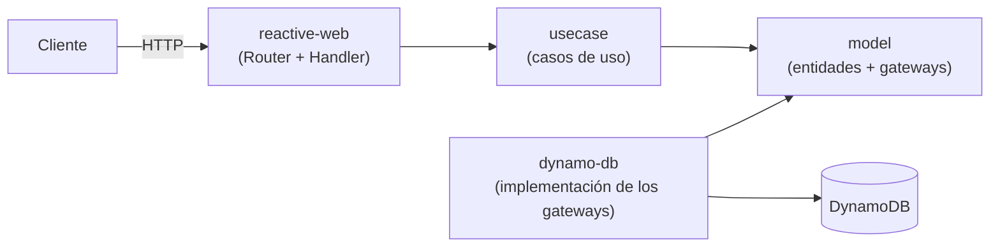

# Franchise API

API REST para administrar franquicias, sus sucursales y los productos de cada sucursal.
Desarrollada como prueba técnica para el rol de Backend Developer en Accenture.

## Tecnologías

- Java 21 y Spring Boot 4.1 con WebFlux (programación reactiva)
- DynamoDB con el AWS SDK v2 (cliente asíncrono *enhanced*)
- Gradle y el plugin de Clean Architecture de Bancolombia (5.2.1)
- JUnit 5, Mockito, StepVerifier y JaCoCo
- Docker, Docker Compose y DynamoDB Local
- Terraform con el proveedor de AWS 6.x

## Arquitectura

La estructura del proyecto se generó con el
[plugin de Clean Architecture de Bancolombia](https://github.com/bancolombia/scaffold-clean-architecture)
y respeta la regla de dependencia: todas las capas apuntan hacia el dominio.



| Módulo | Responsabilidad |
|---|---|
| `domain/model` | Entidades (`Franchise`, `Branch`, `Product`), reglas de validación, interfaces de los gateways y excepciones del dominio. No depende de Spring ni de AWS. |
| `domain/usecase` | Un caso de uso por entidad y uno para el producto con más stock. Solo depende del modelo. |
| `infrastructure/driven-adapters/dynamo-db` | Implementa los gateways con DynamoDB. |
| `infrastructure/entry-points/reactive-web` | API REST con *router functions*, DTOs y manejo de errores. |
| `applications/app-service` | Arranque y configuración de Spring Boot. |

## Modelo de datos

Tres tablas en DynamoDB, sin índices secundarios:

| Tabla | Partition key | Sort key | Otros atributos |
|---|---|---|---|
| `franchises` | `id` | - | `name` |
| `branches` | `franchiseId` | `id` | `name` |
| `products` | `branchId` | `id` | `name`, `stock` |

"Las sucursales de una franquicia" y "los productos de una sucursal" se obtienen con un solo `Query`
por partition key, sin necesidad de hacer un `Scan`.

## Decisiones técnicas

- **DynamoDB con tres tablas.** Las claves siguen la jerarquía franquicia → sucursal → producto, así que
  todas las consultas de la API usan la clave primaria. Un diseño de una sola tabla también funcionaría y
  resolvería el endpoint de mayor stock con una sola consulta, pero es más difícil de modelar y de explicar.
- **Las claves compuestas validan la pertenencia.** Una sucursal se busca con `franchiseId` + `branchId`.
  Si la sucursal no pertenece a la franquicia de la URL, no se encuentra y la API responde 404.
- **Entidades inmutables.** No tienen setters: los cambios crean una copia nueva con `toBuilder()`, y el
  constructor valida los datos cada vez.
- **Router functions** (endpoints funcionales) en lugar de controladores con anotaciones.
- **Borrado físico.** El requerimiento solo pide eliminar productos, sin auditoría ni recuperación.

## Supuestos

- Los IDs son UUID generados por el servidor.
- Los nombres no son únicos.
- Los puntos 5 y 6 del enunciado ("un nuevo producto") se interpretan como "cualquier producto existente".
- Endpoint de mayor stock: si dos productos tienen el mismo stock, gana el primero que devuelve la base de
  datos. Las sucursales sin productos no aparecen en la respuesta, y una franquicia sin sucursales devuelve
  una lista vacía (200).
- La persistencia corre en DynamoDB Local con Docker. Las tablas para AWS están definidas en Terraform
  (`infra/terraform`); en local las crea el script `scripts/create-tables.sh`, así que la definición de las
  tablas existe en dos lugares.

## Requisitos

- Docker y Docker Compose
- Java 21 (solo para ejecutar sin Docker)
- Terraform 1.5 o superior (solo para crear las tablas en AWS)

## Ejecutar con Docker

```bash
docker compose up --build
```

Levanta DynamoDB Local, crea las tablas y arranca la API en `http://localhost:8080`.

Estado de la aplicación: `http://localhost:8080/actuator/health`

## Ejecutar en local con Gradle

Primero levanta solo la base de datos y las tablas:

```bash
docker compose up -d dynamodb-local create-tables
```

Luego, en PowerShell:

```powershell
$env:SPRING_PROFILES_ACTIVE="local"
$env:AWS_ACCESS_KEY_ID="local"
$env:AWS_SECRET_ACCESS_KEY="local"
./gradlew :app-service:bootRun
```

## Endpoints

| Operación | Método y ruta |
|---|---|
| Crear franquicia | `POST /api/franchises` |
| Renombrar franquicia | `PATCH /api/franchises/{franchiseId}` |
| Agregar sucursal | `POST /api/franchises/{franchiseId}/branches` |
| Renombrar sucursal | `PATCH /api/franchises/{franchiseId}/branches/{branchId}` |
| Agregar producto | `POST /api/franchises/{franchiseId}/branches/{branchId}/products` |
| Renombrar producto | `PATCH /api/franchises/{franchiseId}/branches/{branchId}/products/{productId}` |
| Modificar stock | `PATCH /api/franchises/{franchiseId}/branches/{branchId}/products/{productId}/stock` |
| Eliminar producto | `DELETE /api/franchises/{franchiseId}/branches/{branchId}/products/{productId}` |
| Producto con más stock por sucursal | `GET /api/franchises/{franchiseId}/top-stock-products` |

### Ejemplo de uso

Reemplaza `{franchiseId}`, `{branchId}` y `{productId}` por los `id` que devuelve cada respuesta.
En Windows, usa Git Bash o `curl.exe`.

```bash
# Crear una franquicia
curl -X POST http://localhost:8080/api/franchises \
  -H "Content-Type: application/json" -d '{"name": "Burger Co"}'

# Agregar una sucursal
curl -X POST http://localhost:8080/api/franchises/{franchiseId}/branches \
  -H "Content-Type: application/json" -d '{"name": "Centro"}'

# Agregar un producto
curl -X POST http://localhost:8080/api/franchises/{franchiseId}/branches/{branchId}/products \
  -H "Content-Type: application/json" -d '{"name": "Hamburguesa", "stock": 10}'

# Modificar el stock
curl -X PATCH http://localhost:8080/api/franchises/{franchiseId}/branches/{branchId}/products/{productId}/stock \
  -H "Content-Type: application/json" -d '{"stock": 50}'

# Producto con más stock por sucursal
curl http://localhost:8080/api/franchises/{franchiseId}/top-stock-products

# Eliminar un producto
curl -X DELETE http://localhost:8080/api/franchises/{franchiseId}/branches/{branchId}/products/{productId}
```

Respuesta del producto con más stock por sucursal:

```json
[
  {
    "branchId": "fee76ae5-a533-4a3f-bcf3-3aea17afea9c",
    "branchName": "Centro",
    "productId": "a751046b-feca-46b5-b1d2-ac2a4bef9763",
    "productName": "Hamburguesa",
    "productStock": 50
  }
]
```

### Errores

Los errores de negocio usan siempre el mismo formato:

```json
{ "status": 404, "error": "Not Found", "message": "Branch not found" }
```

- `400`: datos inválidos (nombre vacío, stock negativo o ausente, cuerpo vacío).
- `404`: la franquicia, la sucursal o el producto no existe.

## Pruebas y cobertura

```bash
./gradlew build jacocoMergedReport
```

Reporte: `build/reports/jacoco/jacocoMergedReport/html/index.html`

54 pruebas. Cobertura de líneas: `model` 93,5 %, `usecase` 100 %, total 44,7 %.

Las pruebas unitarias se concentran en el dominio y los casos de uso, que es donde está la lógica del
negocio. El adaptador de DynamoDB se validó de punta a punta contra DynamoDB Local con Docker.

## Infraestructura como código

Las tablas están definidas en `infra/terraform` (proveedor de AWS, facturación bajo demanda).

```bash
cd infra/terraform
terraform init
terraform plan
terraform apply
```

Las credenciales de AWS se leen del perfil de la AWS CLI o de las variables de entorno.
Para eliminar las tablas: `terraform destroy`.

## Flujo de trabajo con Git

- `main` siempre estable y una rama por bloque de trabajo: `feature/domain-model`, `feature/use-cases`,
  `feature/dynamodb-adapter`, `feature/rest-api`, `feature/docker` y `docs/readme`.
- Cada rama se integró a `main` con un Pull Request y un *merge commit*.
- Mensajes de commit con Conventional Commits.

## Mejoras futuras

- Pruebas unitarias de los adaptadores de DynamoDB y del handler.
- Endpoints `GET` para consultar una franquicia, una sucursal o un producto.
- Desplegar la aplicación en AWS y leer la configuración desde Parameter Store.

## Uso de herramientas de IA

Usé herramientas de IA como tutor durante la prueba: para resolver dudas, revisar mi código y darme pistas.
En algunas partes el apoyo fue mayor (varias pruebas unitarias, parte de la configuración de Docker y del
adaptador de DynamoDB, y la redacción de este README). Todo lo revisé y lo puedo explicar.
